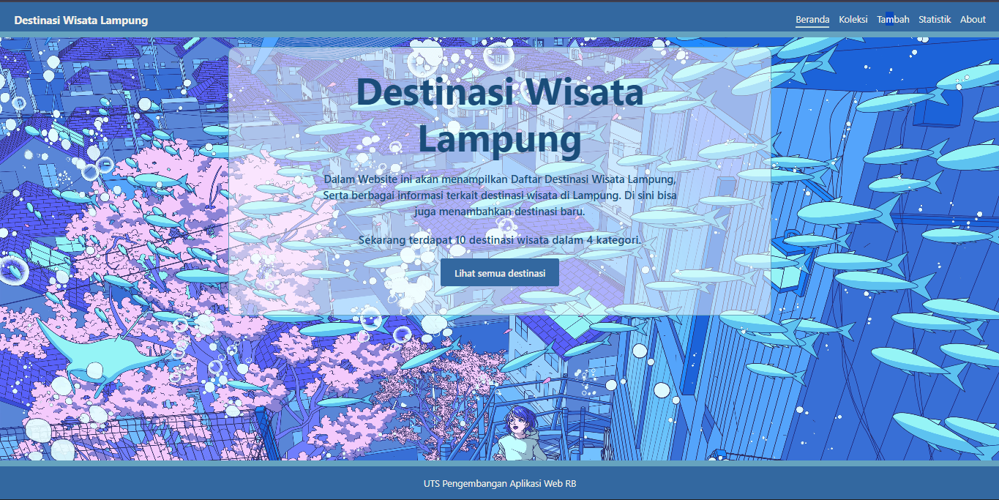

# Nama Aplikasi

- Nama: Baginda Parulian Siregar
- NIM: 124140135
- Kelas: RB
- Tema: Destinasi Wisata Lampung
- Deployment: https://TheLast3070.github.io/uts-paw/

## Fitur

- Dapat mendaftarkan Wisata Lampung yang baru
- Dapat melihat Daftar Wisata Lampung mulai dari nama wisata, kategori, lokasi kabupaten, harga tiket masuk dan jam bukanya
- Dapat melihat statistik berapa banyak data Wisata Lampung yang terdaftar pada web
- Dapat menghapus Data Wisata Lampung yang ada
- Bisa mencari Wisata Lampung berdasarkan nama wisatanya
- Bisa mencari wisata lampung berdasarkan Kategorinya

## Menjalankan secara lokal

- cd app
- npm install
- npm run dev

## Konsep React yang dipakai

- Komponen fungsi, props, dan children ( KartuItem, KotakPencarian, Rupiah, TombolKembali)
- useState dan useEffect (form, pencarian, filter kategori, memuat data, localStorage)
- Context API seperti createContext, Provider, dan useContext (KoleksiProvider dan useKoleksi)
- hook (useKoleksi dan useLocalStorage)
- fetch dengan async/await serta state loading dan error
- Controlled form dengan validasi, ada di halaman tambah
- Rendering daftar dengan map dan key, serta conditional rendering